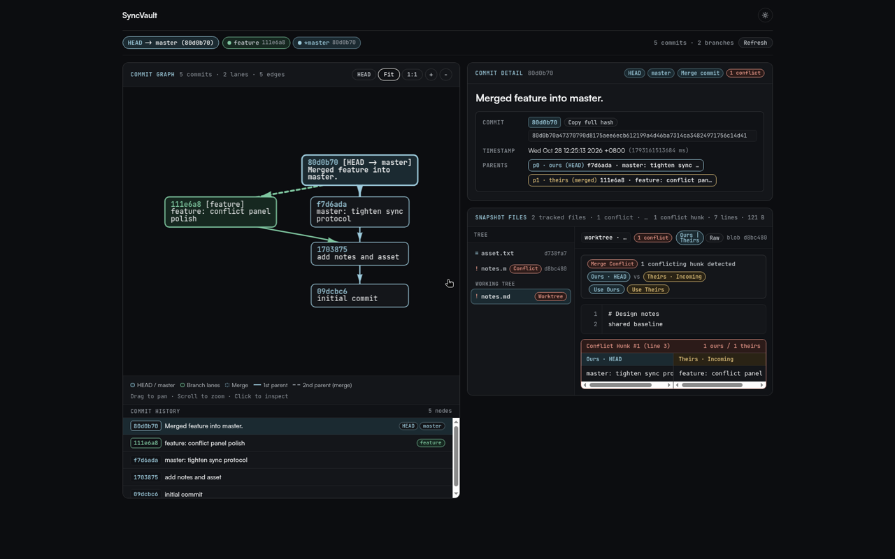
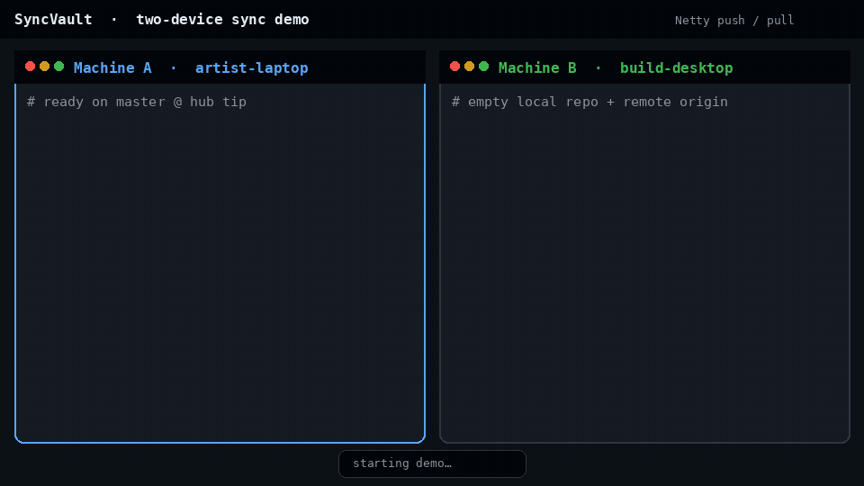

# SyncVault

> 多设备资产同步引擎：一个用 Java 实现的 Git 子集，带 Netty 同步协议、SQLite 单库存储和可视化冲突面板。



<p align="center"></p>

<p align="center"></p>

**技术栈**：Java 17 · Netty 4 · SQLite（sqlite-jdbc）· Maven · JUnit 5 · Python 集成测试 · GitHub Actions

**一句话**：两台机器之间能安全地同步一个版本库——并发 push 不会丢提交，传输中被篡改的对象会被拒绝，写到一半断电也能恢复。

## 这个项目想解决什么问题

同步多份数据副本时，真正难的不是"把文件传过去"，而是这几件事：

| 问题 | SyncVault 的做法 | 在哪里 |
|---|---|---|
| 两个设备同时 push 同一分支，后到的覆盖先到的 | push 携带 `expectedOldTip`，服务端在仓库锁和单个 SQLite 事务里做 compare-and-swap，并拒绝非快进更新 | [design.md](docs/design.md) 的 Push 流程 |
| 对端发来的对象内容和声称的 id 不一致 | 入库前用当前哈希函数重算 blob 和 commit，不一致整笔回滚 | `NettyServer` / `Store` |
| 反序列化不可信输入 | 放弃 Java 原生序列化，改用带魔数与版本号的显式编码（SVC1 提交 / SVM1 同步帧） | design.md 的 SVC1 / SVM1 |
| GC 清理时恰好有 push 在写入，新对象被误删 | `RepoLock`（JVM `ReentrantLock` + OS `FileLock`）互斥，加对象宽限期与在途写入登记 | `RepoLock` / `Store` |
| checkout / merge 写工作区到一半崩溃，留下半残状态 | 临时文件 + `ATOMIC_MOVE`，多文件操作写 journal，提供 `abort` / `continue` 恢复 | `WorkspaceJournal` |
| criss-cross 合并时选错分裂点 | 用递归 CTE 求公共祖先并排除被其他公共祖先支配的节点 | design.md 的 CTE 一节 |
| 冲突难以阅读和解决 | 行级 diff3 + Web 冲突面板，支持 Use Ours / Use Theirs | `Diff3` / `WebServer` |

## 架构

```text
   CLI（Main）          Web UI（DAG + 冲突面板，仅本机）
        │                      │
        └──────────┬───────────┘
                   ▼
        Repository（命令）· Diff3 · WorkspaceJournal
                   │
        ┌──────────┴───────────┐
        ▼                      ▼
   Store（SQLite 单库）    NettyClient ⇄ NettyServer
   .syncvault/syncvault.db  SVM1 帧 · 共享令牌 · 可选 TLS
```

SQLite 中有对象、提交元数据、父子关系、引用、暂存新增 / 删除、远程、元数据共 8 张表，所有写操作的事务边界见 [design.md](docs/design.md)。

## 30 秒体验

```bash
mvn -B package -DskipTests
SV="java -jar $(pwd)/target/syncvault-0.1.0-SNAPSHOT.jar"

# 终端 A：服务端
mkdir hub && cd hub && $SV init && $SV serve 9418

# 终端 B：客户端（同样先定义一次 SV 变量）
mkdir dev1 && cd dev1 && $SV init
echo hello > a.txt && $SV add a.txt && $SV commit "first"
$SV add-remote origin localhost:9418
$SV push origin master

# 看提交图和冲突面板
$SV web 8080     # 浏览器打开 http://127.0.0.1:8080
```

令牌鉴权、TLS（`nettys://`）、`gc`、`fsck`、`resolve` 等完整命令见 [docs/commands.md](docs/commands.md)。README 顶部 GIF 由真实 CLI 录制，可复现：`bash scripts/record-demo.sh`（需本机已装 [VHS](https://github.com/charmbracelet/vhs)，见 [scripts/demo.tape](scripts/demo.tape)）。

## 验证与数据

**测试**：90+ 个 JUnit 5 用例（同步协议编码、CAS 与 push/GC 互斥、工作区原子性、fsck、Diff3、Web API 等）；Python 驱动的命令级集成测试；CI 在每次 push / PR 上跑构建、集成测试和基准 harness 冒烟。

**10 客户端并发 push 压测**（`scripts/concurrent-push-test.sh`，真实 JAR、真实 TCP）：

- 10 个客户端竞争同一分支，被拒绝后经 `pull` 重试，10/10 最终成功
- 55 次 push 尝试：CAS 拒绝 1 次，非快进拒绝 44 次
- hub 最终 DAG 共 56 个提交（1 初始 + 10 客户端 + 45 合并）；hub 与各客户端 `fsck` 均通过，文件与提交信息齐全

**微基准**（预热 1 次 + 采样 5 次，单位 ms，原始数据见 [docs/bench-results.csv](docs/bench-results.csv)）：

| 规模 | 操作 | 中位数 | p95 |
|---:|---|---:|---:|
| 1,000 提交 | 单次 add+commit（均值） | 2.39 | 2.45 |
| 1,000 提交 | `log` | 15.47 | 21.53 |
| 1,000 提交 | Netty push 全部历史 | 199.08 | 237.82 |
| 10,000 提交 | 单次 add+commit（均值） | 1.99 | 9.87 |
| 10,000 提交 | `log` | 155.54 | 203.40 |
| 10,000 提交 | Netty push 全部历史 | 1,689.93 | 1,759.43 |

与同机 `git 2.47.3` 对照（1,000 提交，中位数）：`log` 15.47 ms 对 15.45 ms；`checkout` 7.22 ms 对 3.46 ms（SyncVault 更慢，因为要写 journal 并更新 SQLite）。`status` 与批量 `commit` 的差距主要来自 SyncVault 在热 JVM 内执行、git 每次启动新进程，**不是同口径的性能优势**。

> 10,000 提交的批量 commit 有一次样本明显偏慢（p95 远高于中位数），目前推测与测试机 ext4 刷盘有关，尚未在 tmpfs 上对照验证。完整方法、环境与复现命令见 [docs/benchmarks.md](docs/benchmarks.md)。

## 设计取舍与已知局限

- **为什么是 SQLite 而不是文件目录或 MySQL**：离线可用、单文件零配置、成熟的事务与崩溃恢复，详见 design.md。
- **服务端目前对所有连接串行处理**：`NettyServer` 以会话为粒度加锁，并发能力受限于此；压测验证的是一致性，不是吞吐。
- **同步以整批对象为单位**：单帧上限 64 MB，尚无分批 / 流式传输，超大历史的首次 push 会受此限制。
- **鉴权是共享令牌**：未配置令牌时默认免密（为兼容旧用法），实际使用应开启令牌与 TLS。
- **不兼容旧库**：提交 id 的计算方式已改变，旧仓库需要重新 `init`。
- **基准范围有限**：工作区仅 5 个小文本文件，不覆盖大文件和二进制。

## 目录结构

```text
src/main/java/syncvault/    核心：Repository · Store · Diff3 · NettyServer/Client · SyncMessage · RepoLock · WorkspaceJournal · WebServer
src/main/resources/web/     Web UI（Vis.js 提交图）
src/test/java/syncvault/    JUnit 5 测试
tests/integration/          Python 驱动的命令级集成测试
scripts/                    run-integration-tests.sh · bench.sh · concurrent-push-test.sh · demo.tape · record-demo.sh
docs/                       design.md（设计与协议）· commands.md（命令参考）· benchmarks.md · bench-results.csv
.github/workflows/          ci.yml（构建 · 集成测试 · bench --smoke）
```

## 路线图

- [x] SQLite 单库存储与事务边界
- [x] Netty push / fetch / pull、共享令牌与可选 TLS
- [x] push CAS、对象哈希校验、显式编码替换 Java 序列化
- [x] GC 与 push 互斥、`fsck`、工作区原子写入与 journal 恢复
- [x] Diff3 行级合并、`resolve`、Web 冲突面板
- [x] 多采样基准、同机 git 对照、10 客户端并发压测

## 背景

由 CS61B Gitlet 演化而来（[NelxJoe306/Gitlet](https://github.com/NelxJoe306/Gitlet)），在其基础上重做了存储层，并新增同步协议、完整性校验、GC / fsck、崩溃恢复、Diff3 与 Web 界面。
